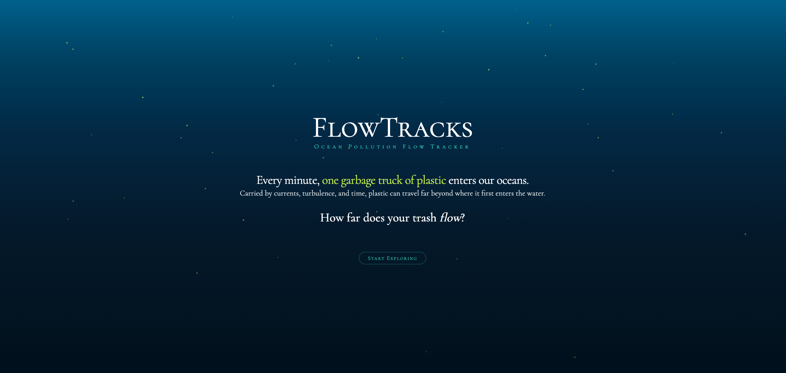
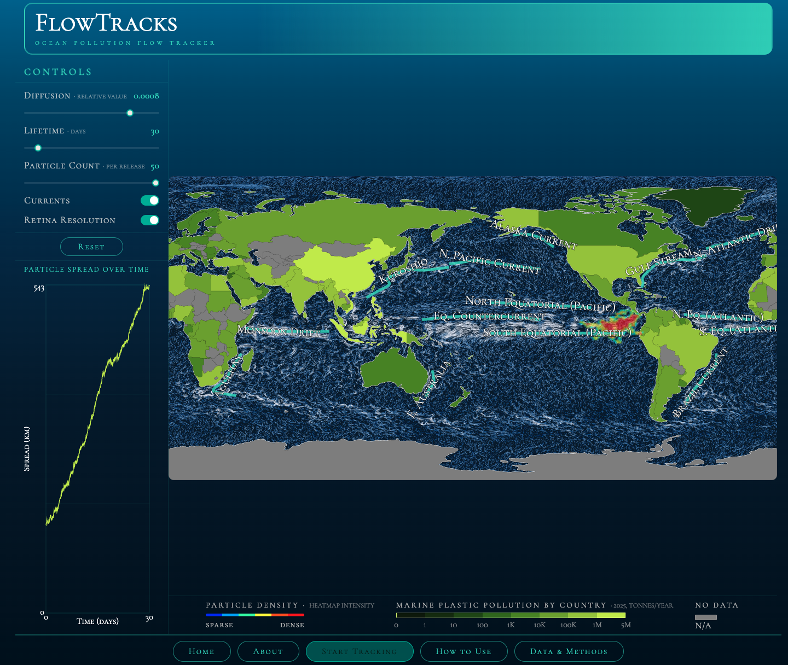

# 🌊 FlowTracks

**An interactive ocean plastic pollution simulation exploring how currents, turbulence, and time shape the movement of marine debris.**

### 🌎 Explore

[**Launch the interactive simulation →**](https://flowtracks-6dd79f.pages.cs.washington.edu/)  
[**Watch the project presentation →**](https://www.youtube.com/watch?v=chJm-dDMmVw)

### 🗺️ About

FlowTracks is an interactive data visualization that allows users to explore how plastic pollution moves through the world's oceans. Users can release virtual particles, adjust diffusion and particle lifetime, visualize ocean currents, and observe how marine debris disperses and accumulates over time.

The project combines projected marine plastic pollution estimates with ocean surface current data to make complex patterns of transport and dispersion explorable through an interactive visual interface.

### 🖥️ Technologies & Methods

- JavaScript and D3.js
- WebGL-accelerated particle simulation
- Interactive geographic data visualization
- Ocean surface current modeling
- Particle advection and diffusion
- Scientific data visualization and interaction design

### 🚀 Team & Contributions

- **Samantha Eaton** — design, front-end development, and user experience
- **Julio Chavez** — particle dispersion modeling and simulation development
- **Baback Elmieh** — project presentation and video production

FlowTracks was developed as a collaborative final project for **CSE 512: Data Visualization** at the **University of Washington's Paul G. Allen School of Computer Science & Engineering** in Spring 2026.

### 📗 Data & References

FlowTracks incorporates ocean surface current data from **OSCAR (Ocean Surface Current Analysis Real-time)** and published estimates of marine plastic pollution.

Full methodology, data sources, and references are documented within the [live project](https://flowtracks-6dd79f.pages.cs.washington.edu/).
